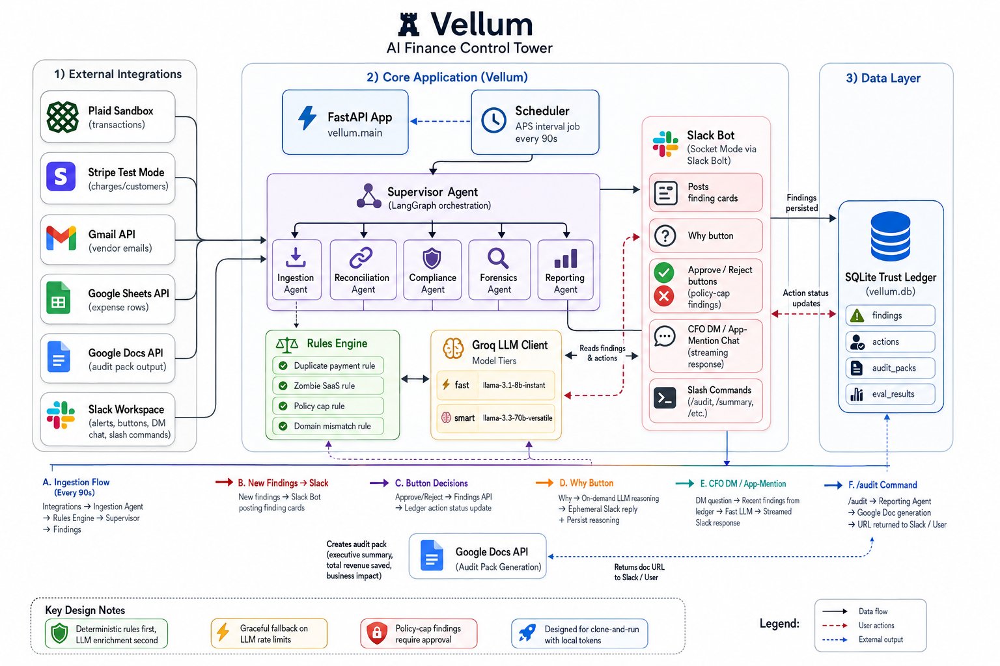

# Vellum

**A finance controller agent for startups, built in a 5-hour hackathon.**

Every 90 seconds, Vellum pulls Plaid sandbox transactions, Stripe charges, expense-sheet rows and vendor email. It runs deterministic checks for:
- duplicate payments
- recurring SaaS charges
- meals over the policy cap
- bank-change requests sent from a domain that doesn't match the vendor's

Each new finding is posted to Slack. A finding records the transaction IDs behind it and gets an LLM explanation on demand. Findings that need a decision also get Approve/Reject buttons.

> Hackathon prototype (May 2026, two-person team). It was built and demoed against the Plaid sandbox, Stripe test mode, one Google account and one Slack workspace. See [Status](#status) for what is and isn't wired.

## What it catches

| Check | Rule (`vellum/rules/`) | Severity |
|---|---|---|
| Duplicate payment | Same vendor name, amounts within 2%, at most 7 days apart | high if the larger charge is above $1,000, else medium |
| Recurring SaaS with no usage | 2+ charges from one vendor, each 25–35 days after the previous one, amounts within 5%, no usage signal in the last 30 days | low under $500, medium from $500 |
| Meal over policy cap | `meal` expense whose description says "N attendees", total above $150 × N | medium; needs approval |
| Vendor bank-change email | Body contains "update bank", "new wire" or "change account" and names a vendor in the registry, but the sender's domain differs from the vendor's | critical |

**Rules decide; the LLM explains.** A finding only exists if a rule fires. The LLM adds a reasoning trace and may raise the severity, never lower it. If the LLM call fails or times out, the finding keeps the rule's severity and gets a placeholder note.

## How it works



*The diagram shows a `/summary` command, but only `/audit` is implemented.*

1. **Ingest.** An APScheduler job (`vellum/scheduler.py`) fetches Plaid, Stripe, Gmail and Google Sheets concurrently every 90 s.
   - Plaid transactions, Stripe charges and sheet rows become a typed Pydantic `Transaction` (`vellum/contracts.py`).
   - Emails go straight to the bank-change rule.
   - A source that isn't configured, or that errors, contributes nothing to that cycle.
2. **Supervise.** A LangGraph state graph (`vellum/agents/supervisor.py`) runs three steps in order:
   - reconciliation (duplicates, recurring SaaS)
   - the meal-cap check plus LLM forensics enrichment
   - a reporting step
3. **Tier the models.** `vellum/groq_client.py` routes work across two Groq models:
   - Cheap calls (categorization, triage labels, Slack chat) go to `llama-3.1-8b-instant`.
   - Reasoning calls (forensics enrichment, "Why?" explanations, executive summaries) go to `llama-3.3-70b-versatile`.
   - Calls that need structured output use JSON mode, and cacheable calls go through an in-process response cache.
   - Timeouts and server errors retry with 1/2/4 s backoff. Rate-limit and daily-quota errors fail fast.
   - Forensics enrichment is capped at 8 findings per cycle, with an 8 s timeout each.
4. **Act in Slack.** `vellum/integrations/slack_app.py` (Slack Bolt, Socket Mode) posts a Block Kit card for each new finding to the alerts channel.
5. **Record.** A SQLite ledger (`vellum/ledger.py`) stores findings, action decisions with the approver, Slack message timestamps and audit packs. Findings already in the ledger are not posted again.

## In Slack

- **Why?** shows an explanation that only you can see. If the finding has no reasoning yet, one is generated on demand and saved.
- **Approve / Reject** appears when a finding carries an action that needs approval (today, meal-cap findings only). It records the decision and the Slack user who made it, then replaces the buttons on the card. It doesn't execute anything else.
- **DM or @mention** the bot, e.g. *"What's the most urgent thing you found today?"* The fast model answers from the most recent findings of the last 24 h and streams the reply into Slack. If the LLM is unavailable, a fixed fallback answer is used instead.
- **`/audit [last_30_days | YYYY-MM]`** creates a Google Doc audit pack for the period and returns the link. The doc has an LLM executive summary, the findings list, and a dollar total of the amounts attached to approval actions.

HTTP API (`vellum/main.py`, `vellum/api/`):
- `GET /healthz`
- `GET /findings/`
- `POST /findings/{id}/decision`
- `POST /findings/approve`
- `POST /findings/reject`
- `POST /audit/{period}`

The Slack buttons and `/audit` call this API at `VELLUM_API_BASE_URL`.

## Stack

Python 3.11+ · FastAPI · LangGraph · Pydantic v2 · Groq (Llama 3.1 8B / Llama 3.3 70B) · Slack Bolt · Plaid · Stripe · Google APIs (Gmail, Sheets, Docs) · APScheduler · SQLite (aiosqlite, sqlite-utils) · structlog · pytest

## Run it

```bash
git clone https://github.com/Nanda-Kiran/vellum.git
cd vellum
python3 -m venv .venv && source .venv/bin/activate
pip install -e ".[dev]"
cp .env.example .env        # fill in the values below
uvicorn vellum.main:app
```

Before you start:
- The install also pulls in `sentence-transformers` and `chromadb` for the planned policy retrieval, which isn't wired yet. Expect a large download.
- The repo includes a `vellum.db` ledger from the May 2026 demo run. Delete it, or set `VELLUM_DB_PATH`, to start with a clean ledger.

On startup the logs show `scheduler.started`. They also show `slack.socket_mode.started` when both Slack tokens are set. The first ingestion cycle runs 90 s after startup.

| Variable | What it is |
|---|---|
| `GROQ_API_KEY` | Groq API key |
| `SLACK_BOT_TOKEN` / `SLACK_APP_TOKEN` | Bot token (`xoxb-…`) and app-level token with `connections:write` (`xapp-…`) |
| `SLACK_FINANCE_ALERTS_CHANNEL` | Channel for finding cards (default `#finance-alerts`) |
| `PLAID_CLIENT_ID` / `PLAID_SECRET` / `PLAID_ENV` | Plaid sandbox keys; `PLAID_ENV=sandbox` |
| `STRIPE_API_KEY` | Stripe **test** secret key (`sk_test_…`) |
| `GOOGLE_CREDENTIALS_PATH` | Local OAuth user-token or service-account JSON (keep it out of git) |
| `DEMO_SHEET_ID` / `DEMO_SHEET_RANGE` | Expense sheet with columns date, category, description, amount, submitter (default range `Expenses!A:E`) |
| `VELLUM_DB_PATH` | SQLite ledger path (default `./vellum.db`) |
| `VELLUM_API_BASE_URL` | Where the Slack handlers reach the HTTP API (default `http://127.0.0.1:8000`) |

`.env.example` lists only some of these. Add `SLACK_FINANCE_ALERTS_CHANNEL`, `DEMO_SHEET_ID`, `DEMO_SHEET_RANGE` and `VELLUM_API_BASE_URL` yourself when you need values other than the defaults.

**Slack app setup:**
- Turn on Socket Mode.
- In App Home, turn on the Messages tab with "Allow users to send messages".
- Subscribe to the bot events `app_mention` and `message.im`.
- Add the slash command `/audit`.
- Grant the scopes `chat:write`, `app_mentions:read`, `im:read`, `im:history` and `commands`.
- Reinstall the app after changing scopes, and invite the bot to the alerts channel.

### Tests and evals

```bash
pytest                       # rules, contracts, Groq client, reporting
python evals/run_evals.py    # 10 JSONL scenarios through the supervisor graph
```

The eval set (`evals/cases.jsonl`) contains:
- One positive case per rule.
- Near-miss negatives: two charges 3% apart, a meal 1 cent under the cap, and a bank-change email from the vendor's real domain.
- Three mixed cases that check which finding types come out (email only, meal only, both).

How the runner works:
- Meal and email cases load the rule's finding before the graph runs, and the reporting step is stubbed.
- With `GROQ_API_KEY` set, the graph's LLM steps make live Groq calls. Without it, they fall back to the rule output.
- It prints a pass/fail line per case and exits non-zero if any case fails.

### Live demo

```bash
PYTHONPATH=. python data/seed/live_demo_four_issues.py --reset-ledger
```

The demo needs Plaid, Stripe, Google and Slack credentials. It plants one scenario per check, runs the four rules directly (without the LLM), and posts the findings to Slack:
- Two $4,200 Acme Corp charges in Stripe test mode.
- An $890 client dinner for 2 attendees, added to the Google Sheet. If `DEMO_SHEET_ID` is unset, the script creates a demo sheet and prints its ID to add to `.env`. The meal finding then appears on the next run.
- Two made-up monthly Datadog charges, generated inside the script.
- A Gmail draft for the bank-change scenario. Its wording does not trigger the rule, so send your own email instead:
  - Send it to the monitored inbox from an address outside acme.com.
  - The body must name "Acme Corp" and contain "update bank", "new wire" or "change account".
  - Press Enter in the terminal after you send it. `--no-wait-for-gmail` skips this pause.

`--reset-ledger` deletes the local ledger. The running app handles the card buttons, so start or restart `uvicorn` after a reset. That way it opens the fresh ledger.

## Status

Hackathon prototype, not production software.
- Single-tenant: one Google credential file, one Slack workspace, and the Plaid sandbox. Each cycle creates a new Plaid sandbox connection to a test bank. There is no Plaid Link flow for real accounts.
- The meal cap is hard-coded at $150 per person to match `data/policy.md`. Policy retrieval (`vellum/rag/policy_rag.py`) is a stub.
- The vendor list for the bank-change check has one hard-coded entry (Acme Corp → acme.com) in `vellum/scheduler.py`.
- Usage data for the recurring-SaaS check is not connected yet, so every monthly recurring charge is flagged for review.
- Known routing gaps:
  - The graph ends a cycle when reconciliation finds nothing. The meal-cap check therefore only runs in a cycle where a duplicate or recurring-SaaS finding also fired.
  - A cycle that starts with a bank-change finding skips reconciliation.
  - The evals load meal and email findings before the graph runs, so they don't cover this path.
- The HTTP API has no authentication; run it on localhost.
- `/audit` is the only slash command.
